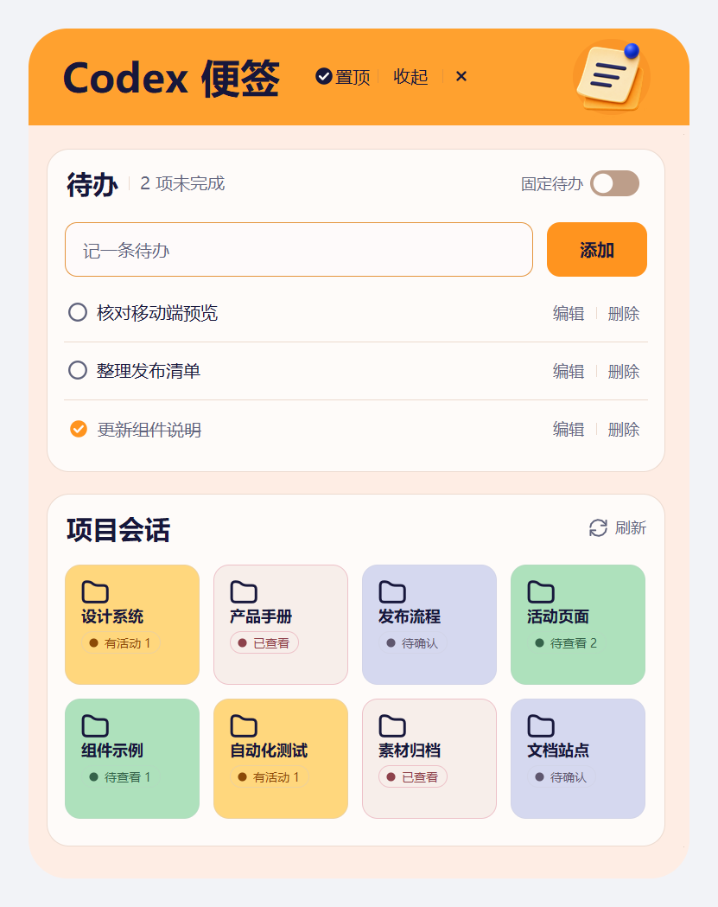
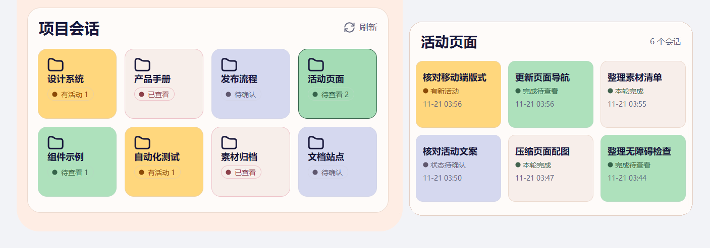
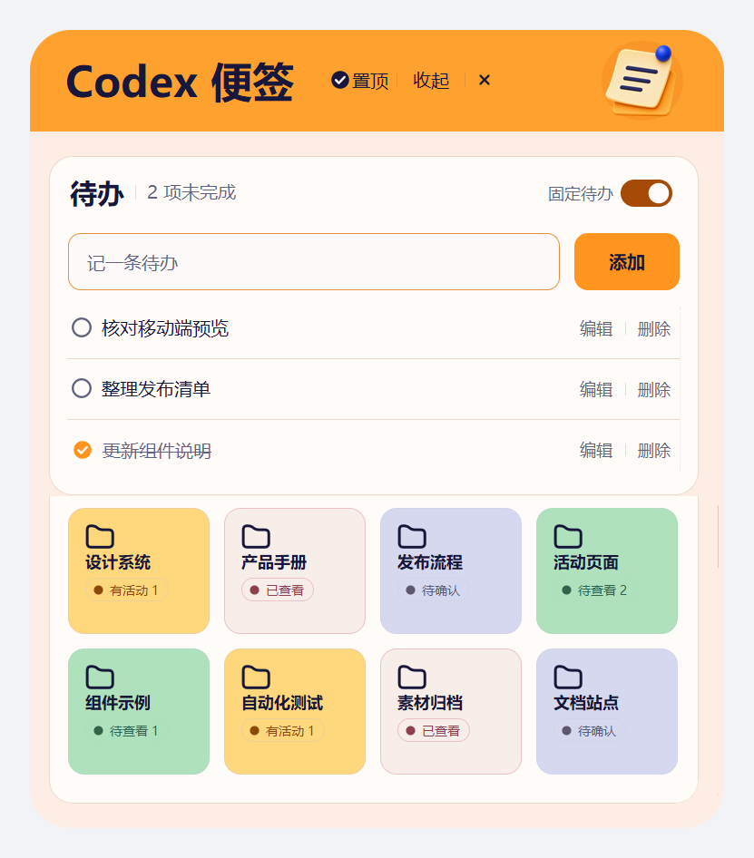

# Codex Sticky Notes

[简体中文](README.md) · English

A desktop window for Codex sessions and to-dos on Windows and macOS.

When you work across several Codex projects, it can take a few trips through the sidebar to see what just finished and what's still active. Codex Sticky Notes puts recent project activity, sessions to review, and your local to-dos in one window. Hover over a project to see its sessions, then click a session card to return to its chat in Codex.

<p align="center">
  
</p>

<p align="center"><sub>The screenshots use fictional example data and show the Chinese interface.</sub></p>

## Get started

### Windows

Extract the portable ZIP and open **Codex Sticky Notes.exe** in the extracted folder. Python is included. You can create a desktop shortcut to the executable. Opening it again brings the existing window back into view.

To run from source, install Python 3.11 or newer with Tkinter, make sure `python.exe` is available from the command line, and double-click **Open-Codex-Sticky-Notes.cmd**.

### macOS

When a native package is available, download the ZIP for your Mac (`arm64` for Apple silicon or `x86_64` for Intel). Extract it, drag **Codex Sticky Notes.app** into Applications, and double-click it. The app bundles Python. The preview build is distributed without Apple notarization. [Apple's guide to opening apps](https://support.apple.com/en-us/102445)

To run from source, install Python 3.11 or newer with Tkinter. Extract the entire source archive and double-click **Open-Codex-Sticky-Notes.command**. From a Git checkout, you can also run `bash ./Open-Codex-Sticky-Notes.command` in the project directory. The official Python installer includes Tk for macOS. [Python on macOS](https://docs.python.org/3/using/mac.html)

You can add to-dos as soon as the window opens. Browsing or opening sessions requires the Codex desktop app and its local history. The chat tools are optional.

### Interface language

Open the **Language** menu in the title bar and choose **System Default**, **简体中文**, or **English**. The default follows your system language. A Chinese system language uses Simplified Chinese. Other or undetected system languages use English. The window updates immediately and keeps your current to-do draft.

The app saves your language preference in `settings.json` alongside `tasks.sqlite`. The same preference applies when the chat plugin opens the window or it launches with Codex.

## Track sessions and to-dos

### Hover over a project to see its sessions

Project cards are ordered by recent activity. The number of columns adjusts to the window width. Hover over a project to open its session list, move the pointer into the list to scroll, and click a session card to reopen its chat. The window refreshes every 15 seconds. You can also refresh it manually.

<p align="center">
  
</p>

### Keep to-dos visible while scrolling projects

Press Enter in the to-do field to add an item. You can edit, complete, reopen, or delete items. Pin the to-do section to keep it visible while the project list scrolls separately. Long to-do lists have their own scroll area.

<p align="center">
  
</p>

### Collapse the window and see when sessions are ready

Drag the orange header to move the window on Windows, or drag the system title bar on macOS. Drag the window edges to resize it. Use the always-on-top option to keep the window in front. Collapsing the window leaves a translucent desktop icon that you can move or click to restore the window.

While the window is collapsed, a blue dot on the icon blinks for one hour when a session becomes **To review**. When another session becomes **To review**, the timer restarts. Restoring the window stops the blinking immediately.

### Card colors

Project and session cards use the same colors. Each session card reflects its own status. For project cards, the first matching row in the table determines the color.

| Status | Background | Project status rule |
| --- | --- | --- |
| To review | Yellow `#FFD77D` | At least one session has completed and is unread |
| Active | Green `#AEE1BC` | At least one session is marked in progress and has a recorded update in the last five minutes |
| Read | Light warm pink `#F7EEEA` | All sessions have ended and are explicitly marked as read |
| Pending | Gray-blue `#D5D8EF` | Other cases, such as missing read status or activity older than five minutes |

## Launch with Codex (Windows, source version)

Once enabled, a monitor runs after you sign in to Windows and checks for the Codex desktop app every three seconds. When Codex starts, the monitor launches Sticky Notes in its collapsed state. Click the translucent icon or double-click the main launcher to open the window.

If you close Sticky Notes manually, it stays closed until you fully quit and reopen Codex.

Run these commands from the project directory to enable automatic launch or check its status. Double-click **Disable-Codex-Autostart.cmd** to turn it off.

```powershell
python -B plugins/codex-sticky-notes/startup.py enable
python -B plugins/codex-sticky-notes/startup.py status
```

Automatic launch uses the `CodexStickyNotes` startup entry for your Windows user. The monitor and the window use your local Python installation. Run the enable command again if you move the project or change the Python installation path.

## Use the optional chat tools

On Windows, run these commands from the source directory to install the dependency, register the local marketplace, and install the plugin.

```powershell
python -m pip install mcp==1.26.0
codex plugin marketplace add .
codex plugin add codex-sticky-notes@local-codex-sticky-notes
```

Select **Codex 便签** in a new chat. You can ask Codex to open Sticky Notes, list recently updated sessions, or add a to-do.

On macOS, register the chat tools with the Codex CLI from the source directory. Keep the source directory and its virtual environment at that location after registration.

```bash
python3 -m venv .venv
.venv/bin/python -m pip install mcp==1.26.0
codex mcp add codex-sticky-notes -- "$PWD/.venv/bin/python" -B "$PWD/plugins/codex-sticky-notes/server.py"
```

Restart Codex to use the tools in chat. If the native Sticky Notes app is installed, asking Codex to open Sticky Notes opens that app first.

## Data and scope

To-dos are stored in `%LOCALAPPDATA%\CodexStickyNotes\tasks.sqlite` on Windows and `~/Library/Application Support/CodexStickyNotes/tasks.sqlite` on macOS. The desktop window and chat tools share the same to-dos on each computer. When you use a chat tool, its returned session summaries or to-dos enter that chat's context.

Sticky Notes reads the local Codex history indexes (`state_5.sqlite` and `thread_history_1.sqlite`) in read-only mode and groups unarchived user sessions by project. Status reflects the records on this computer. Open the original chat to see whether it is waiting for input or approval. View sessions on remote hosts in Codex. The window reports a read error if the local history schema is incompatible.

Project membership and unread status use desktop state saved locally by Codex. Where no explicit project grouping is available, sessions are grouped by working directory. Unread status updates as Codex records it. If Sticky Notes cannot resolve which account's state applies, it shows **Pending**.

## Build desktop packages

Run **Build desktop packages** manually in GitHub Actions to build ZIPs for Windows, Apple silicon Macs, and Intel Macs. To build locally, use a Python installation with Tkinter. PyInstaller builds a package for the system you run it on.

```text
python3 -m pip install PyInstaller==6.22.3
python3 -B scripts/build-desktop.py --output dist
```

On Windows, replace `python3` with `python`.
