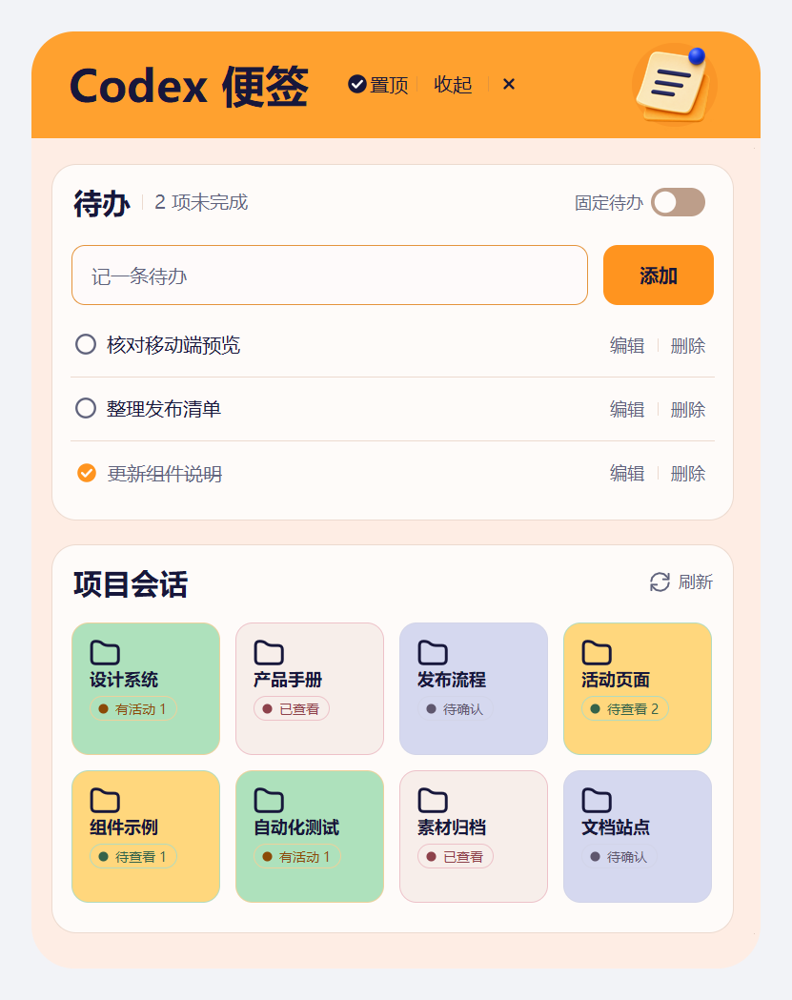
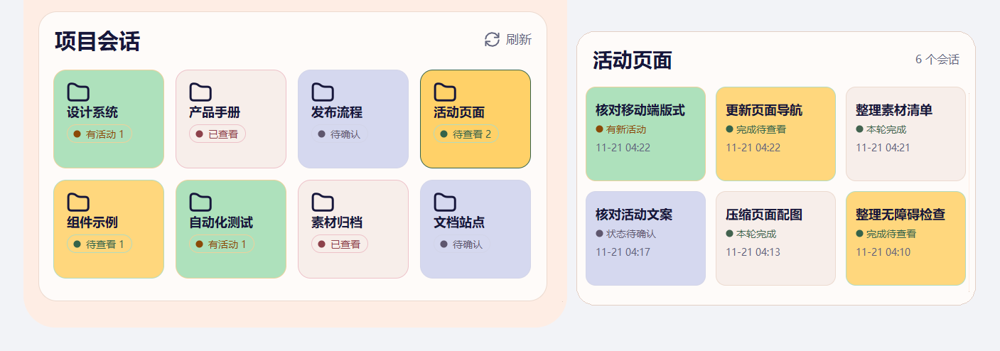
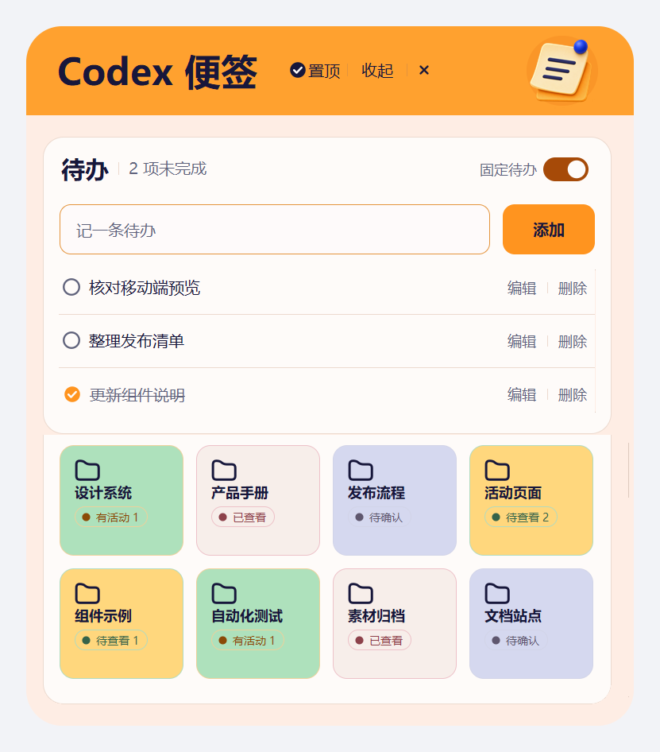

# Codex 便签

Windows 桌面上的 Codex 会话总览和待办便签。

## 解决什么问题

同时处理多个 Codex 项目时，确认哪些会话刚完成、哪些还在进行，常常要来回翻项目和聊天列表。另记的待办也要另外查找。

Codex 便签把本地待办、项目最近活动和待查看会话放在一页。打开小窗即可扫一眼进展，悬停项目可看到其中的会话，点击卡片就能回到原聊天继续处理。

<p align="center">
  
</p>

<p align="center"><sub>截图均使用虚构的示例数据。</sub></p>

## 开始使用

需要 Windows 和带 Tkinter 的 Python 3.11 或更新版本，并确保可以从命令行调用 `python.exe`。启动脚本在打开便签后会自行退出。

双击 **Open-Codex-Sticky-Notes.cmd** 打开橙色主窗口。再次双击会唤回已运行的便签。旧的 **Open-Codex-Sticky-Notes-Orange-Demo.cmd** 快捷入口也会打开同一个窗口。

## 看进展和记待办

### 悬停项目，查看会话

项目卡按最近活动排列，列数随窗口宽度变化。悬停项目可打开会话浮层，移入浮层可滚动，点击任一会话卡可跳回原聊天。便签每 15 秒刷新，也可手动点「刷新」。

<p align="center">
  
</p>

### 固定待办，单独滚动项目

在待办区按回车添加待办，也可编辑、勾选完成、取消完成或删除。打开「固定待办」后，待办留在上方，项目独立滚动。待办较多时，可以在待办列表内滚动。

<p align="center">
  
</p>

### 收起便签，接收待查看提醒

拖动橙色横幅可移动窗口，拖动边缘可调整大小。勾选「置顶」可让窗口保持在前面。点「收起」后，桌面会保留半透明图标，可以拖动或点击恢复。

便签收起时，有会话新转为「待查看」，图标上的蓝点会闪烁。展开便签或在 Codex 里查看这些会话后，提醒停止。

### 卡片颜色

项目与会话卡片使用同一套底色。会话按自身状态取色，项目按下表从上到下的顺序汇总。

| 状态 | 底色 | 项目汇总条件 |
| --- | --- | --- |
| 待查看 | 黄 `#FFD77D` | 至少一个会话已完成且未读 |
| 有活动 | 绿 `#AEE1BC` | 至少一个会话仍在进行，且最近五分钟有记录更新 |
| 已查看 | 浅暖粉 `#F7EEEA` | 所有会话都已结束并明确标记为已读 |
| 待确认 | 灰蓝 `#D5D8EF` | 其余情况，例如缺少已读记录或活动记录已过五分钟 |

## 随 Codex 启动

开启后，监控程序会在登录 Windows 后运行，每三秒检查一次 Codex 桌面程序。它识别到新启动的 Codex 后，会把橙色便签启动为收起状态。点击半透明图标或双击主入口即可展开。

手动关闭便签后，本次 Codex 运行期间会保持关闭。完全退出并重新打开 Codex 后，便签会再次自动出现。

在项目目录运行以下命令可启用或查看状态。双击 **Disable-Codex-Autostart.cmd** 可关闭随 Codex 启动。

```powershell
python -B plugins/codex-sticky-notes/startup.py enable
python -B plugins/codex-sticky-notes/startup.py status
```

自动启动使用当前用户的 Windows 启动项 `CodexStickyNotes`。后台程序和便签使用本机 Python。项目路径或 Python 安装位置改变后，重新运行启用命令即可更新路径。

## 从 Codex 聊天使用

在项目目录安装插件依赖，然后注册本地插件市场并安装「Codex 便签」。

```powershell
python -m pip install mcp==1.26.0
codex plugin marketplace add .
codex plugin add codex-sticky-notes@local-codex-sticky-notes
```

安装后，在新聊天中选择「Codex 便签」。可以说「打开便签」唤回橙色窗口，也可以说「看看最近有哪些会话在更新」或「记一条待办：检查安装包」。

## 数据和适用范围

待办在 `%LOCALAPPDATA%\CodexStickyNotes\tasks.sqlite`。小窗直接在本机读写。通过聊天调用插件时，工具返回的会话摘要或待办会进入该聊天上下文。

会话只读访问本机 Codex 历史索引（`state_5.sqlite` 和 `thread_history_1.sqlite`），按项目汇总未归档的用户会话。便签展示的是本机记录中的状态，是否正在等待用户输入或审批，需要回原聊天确认。远程主机的会话请在 Codex 中查看。历史索引结构不兼容时，便签会提示读取失败。

项目归属及未读状态会参考 Codex 在本机保存的桌面状态。缺少显式分组时，按工作目录归类。未读状态随 Codex 客户端记录更新，多份账号状态无法确定归属时显示待确认。
